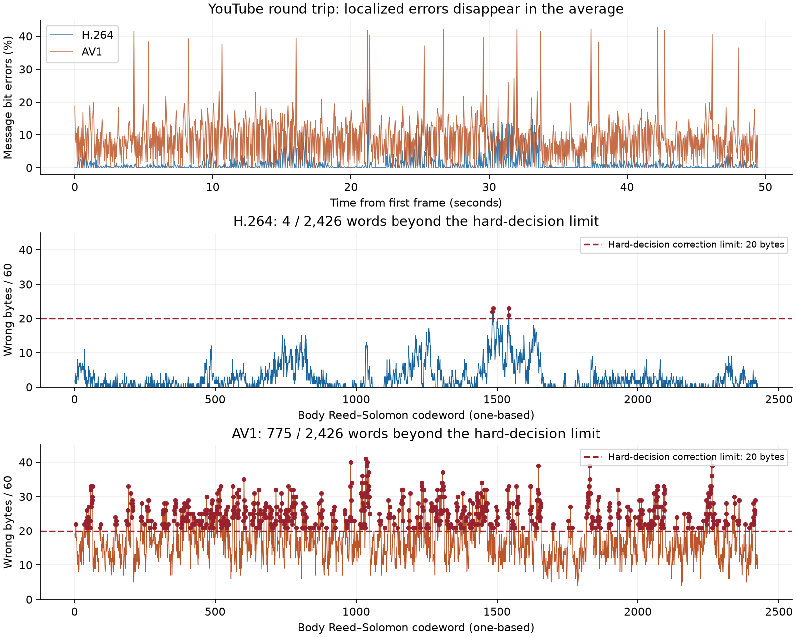

# NDCA implementation and YouTube robustness audit

Date: 2026-10-08. Reviewed the current working tree, including uncommitted NDV5 changes; base commit `92efb40e24a08fa1c11a4e63e9cb1b90e58f0cff`.

**Production integration update (2026-10-08):** The confidence-guided body RS
fallback is now integrated into the normal `video_decode.py` path. The production
CLI recovered all 48,485 H.264 payload bytes with the expected SHA-256 and valid
EPUB ZIP checks: four codewords required 32 erased positions total. AV1 remains
unrecoverable (first unrepaired word 45) and creates no output. Existing
regressions and the new confidence-decoder tests pass. No extra parity or new
upload was needed. [Production verification record](../benchmark-runs/youtube-2Mx3Aq-qK0I/production-decoder-result.json).
The audit below is the historical pre-integration assessment; its references to
an unchanged production decoder describe that earlier state.

**The core algorithm is a credible NDCA implementation, but this is not an exact experimental reproduction. More importantly, the latest H.264 download already contains enough information to recover the complete file without additional redundancy.** During this audit, a confidence-guided Reed–Solomon diagnostic recovered the original 48,485-byte EPUB from format 137. The normal production decoder still fails. AV1 remains unsuccessful.

The highest-value next change is to preserve coefficient confidence through extraction and use RS errors-and-erasures decoding. This changes the receiver, costs **zero payload capacity**, and requires no new upload for this H.264 artifact. Deeper interleaving is the next promising change; it also need not add parity bytes.

## Evidence and scope

I read the complete 18-page paper, including its equations, ten figures, five tables, experimental settings, and limitations. I reviewed every non-ignored project source/document and the explicitly permitted [YouTube experiment](../benchmark-runs/youtube-2Mx3Aq-qK0I/REPORT.md), including its JSON diagnostics and downloaded pixels. Other ignored research, benchmarks, tests, materials, and runs were excluded. The existing Python environment was used to execute diagnostics.

Production code and the original benchmark report were left unchanged. New diagnostic artifacts are confined to that experiment directory; this report and its chart are under `docs/`.

**Reference facts needed for the comparison.** The reference pipeline uses U-plane DWT/LL-SVD, parity quantization, upper/left neighboring-block differences, STC embedding, and RS correction. Equations 15–17 define the two cost models. Experimental settings specify STC height 3, RS(60,20), and capacity payload parameter 0.5. Main-experiment delta is derived from the mean AQIM step of the comparison method; the 30/40/50 sweep is not a universal production prescription. The dataset uses 300-frame, 30-fps clips at 480p/720p. Table 3 reports YouTube BERs of 0.85%/0.41% and 20/20 successful videos at each resolution. Success means zero post-ECC message BER, not merely a readable preview. AV1 is outside the evaluated codec set. Exact wavelet, numeric block dimensions, STC matrices, RS symbol representation/interleaving, upload settings, and downloaded rendition identifiers are not sufficiently specified for byte-exact reproduction. Equation 16 normalizes over the candidate sequence; its notation is video-wide, while implementation granularity remains uncertain. [Gan et al., paper §§2–5, Table 3 and footnote 5](https://link.springer.com/article/10.1186/s13635-025-00214-6), [PDF](https://link.springer.com/content/pdf/10.1186/s13635-025-00214-6.pdf).

## 1. What actually failed—and what recovered during this audit

The original [H.264 measurements](../benchmark-runs/youtube-2Mx3Aq-qK0I/result-f137.json) contain 2,426 body codewords. Four have 22, 23, 23, and 21 wrong bytes; the hard-decision budget is 20 per word. Everything else being correct cannot compensate for those four local overruns. The all-or-nothing rejection is appropriate for a binary file.

| Measurement | H.264, format 137 | AV1, format 399 |
| --- | ---: | ---: |
| Protected headers recoverable | 3/3 | 1/3 |
| Message BER including headers | 1.307% | 8.900% |
| Body-only BER, recalculated | 1.310% | 8.894% |
| Wrong body bytes / all body bytes | 6,911 / 145,560 | 43,788 / 145,560 |
| Body byte error rate | 4.748% | 30.082% |
| Codewords beyond 20 wrong bytes | 4 / 2,426 | 775 / 2,426 |
| Production hard-decision recovery | Failed | Failed |
| Audit confidence/erasure recovery | **Complete, exact** | Failed |

Format 270 has the same decoded-pixel hash and error measurements as 137 in the original experiment. It is not an independent successful/failed channel sample; the new probe was run on 137 and 399.



The H.264 average hides considerable variation. The worst message-bearing frame has 235/984 wrong bits, approximately 23.88%. The two eight-word groups containing failures have these byte-error counts:

```text
Words 1481–1488: 14, 20, 22, 18, 20, 23, 19, 19   (155 wrong bytes)
Words 1537–1544: 13, 18, 13, 15, 16, 23, 21, 15   (134 wrong bytes)
```

Each group has a nominal aggregate allowance of 8 × 20 = 160 errors, but the independent codewords cannot share that allowance. This is a distribution problem, not proof that the total parity volume is insufficient. Reassigning the errors would require a different embedding/interleaving experiment; this arithmetic alone does not establish that any particular permutation will succeed.

**The successful diagnostic.** For each received carrier coefficient `c`, the probe calculated distance to its nearest quantizer boundary:

```text
margin = delta × (0.5 − abs(c/delta − round(c/delta)))
```

It propagated the minimum supporting-carrier margin through the actual STC parity equations, then took the minimum bit margin within each byte. After applying the existing byte deinterleaving to both bytes and scores, it tried ordinary RS decoding first. For each failed word, it ranked bytes by increasing confidence and tried erasing the first 1 through 32 positions. The first successful result was selected; the whole-file CRC and padding were then checked. This ranking is a heuristic, not a calibrated probability model.

| Failing word | Original wrong bytes | First successful erasure count | Distinct decoded candidates across successful trials |
| --- | ---: | ---: | ---: |
| 1483 | 22 | 10 | 1 |
| 1486 | 23 | 12 | 1 |
| 1542 | 23 | 8 | 1 |
| 1543 | 21 | 2 | 1 |

The probe neither read the original payload nor used benchmark error positions or the expected hash to choose repairs. It discovered failed words through RS exceptions. After recovery, the resulting SHA-256 was compared with the existing benchmark record:

```text
5b6429d7ce84c6a88a93a0daa4253c6e56ae58ce0e215c9f3a82220b757882f8
```

The filename/payload CRC, zero padding, file length, expected SHA-256, and the EPUB's internal ZIP CRC checks all pass. Batched diagnostic extraction was checked against production `extract_chunk()` on **all 1,187 message-bearing frames**, with identical extracted bytes.

The recovered file is [audit-recovered-die-verwandlung.epub](../benchmark-runs/youtube-2Mx3Aq-qK0I/audit-recovered-die-verwandlung.epub). Full results: [H.264](../benchmark-runs/youtube-2Mx3Aq-qK0I/audit-erasure-f137.json), [AV1](../benchmark-runs/youtube-2Mx3Aq-qK0I/audit-erasure-f399.json). AV1 produced 775 hard-decision failures; 415 had no successful candidate even in this erasure sweep, and the final CRC failed. No AV1 payload was saved. RS accepting an individual candidate is not sufficient evidence of correctness.

This establishes one successful recovery from one H.264 rendition. It does **not** establish reliable recovery across videos, codecs, or future YouTube encodes.

## 2. How faithfully the implementation follows the algorithm

| Component | Current implementation and assessment |
| --- | --- |
| Transform and carrier | [ndca.py](../core/ndca.py#L42) takes the largest singular value of a Haar LL band, reconstructs with the other singular values/detail bands preserved, and operates on U. Structurally consistent with §2. |
| Quantization | [ndca.py](../core/ndca.py#L31) extracts rounded-index parity. [video_stego.py](../core/video_stego.py#L16) searches same-parity centers and checks reconstructed pixels. Nominal mapping matches; the bounded fallback search is project-specific. |
| Neighbor costs | [ndca.py](../core/ndca.py#L64) uses floating-point mean absolute differences from upper/left blocks. The multiply/divide directions and epsilon in both cost models agree with Eqs. 15–17. I found no cost-sign inversion. |
| STC | [stc.py](../core/stc.py#L13) defines explicit height-three matrices and correctly minimizes absolute candidate costs. Forty small random problems passed exhaustive feasible-vector/minimum-cost checks during this audit. Matrix identity with the authors is unverified. |
| RS body | [ecc.py](../core/ecc.py#L18) explicitly uses 20 data bytes plus 40 parity bytes, with matching encode/decode parameters. It correctly fixes at most 20 unknown erroneous bytes per word; it currently supplies no erasures. |
| File assembly | [framing.py](../core/framing.py#L143), [layout.py](../core/layout.py#L41), and [frame_reader.py](../core/frame_reader.py#L18) separate bootstrap repair, body repair, and integrity validation. Exact recovery in the diagnostic argues against a packing/alignment defect in this run. |

The configured **matrix profiles** are the credible baseline for evaluating NDCA. The CLI's default `legacy` profile is a separate four-state construction. A successful lossless round trip establishes internal consistency, but it cannot establish robustness to the lossy channel.

STC is an embedding optimizer, not the layer that repairs transmission errors. Its parity relations can spread one damaged carrier into several wrong message bits. The [original STC authors' description](https://dde.binghamton.edu/download/syndrome/) makes this distinction explicit; treating a larger trellis as stronger error correction would be a mistake.

## 3. Dangerous differences, limitations, and unresolved choices

### A. Hard decisions discard useful information — demonstrated limitation, highest priority

[extract_chunk()](../core/video_stego.py#L98) returns only bytes, discarding every coefficient's distance from a quantization boundary. [decode_body()](../core/ecc.py#L64) consequently treats all bytes as equally trustworthy and calls `decode()` without erasure positions.

The H.264 probe demonstrates the practical cost of this design: the received file is recoverable with the existing parity, yet production recovery fails. This is an engineering opportunity within the current transform/STC/RS architecture, not an allegation that an explicit soft-decoding step was omitted from the paper.

For the existing 40 parity symbols, the mixed error/erasure condition is `2e + s <= 40`, where `e` counts unknown errors remaining outside the `s` erased positions. Erasing a genuinely bad byte helps; erasing a correct byte spends budget. `reedsolo` already supports this interface. [reedsolo 1.7.0 documentation](https://pypi.org/project/reedsolo/1.7.0/).

**Action:** add confidence-aware extraction and bounded erasure retries to the decoder, retaining all existing CRC, length, filename, and padding checks. Handle candidate ambiguity explicitly. Validate on holdout clips and corrupted inputs before calling it reliable. No wire-format or encoder change is required if confidence is derived from the current mapping.

### B. Eight-word interleaving is too local for some observed bursts — measured exposure

[ecc.py](../core/ecc.py#L39) interleaves only 480 encoded bytes at a time. At 1080p/ROBUST80's 123 bytes per frame, a group occupies about 3.90 frame-equivalents, or 0.163 seconds; alignment can make it touch five frames. A several-frame bad region therefore damages most of the same eight RS words.

The failing groups around frames 725–729 and 753–757 are direct evidence of this exposure. The interleaver is internally correct; its temporal reach is insufficient for these particular concentrations.

**Action:** compare depths 32, 64, and 256 or a deterministic full-body permutation while keeping RS(60,20), delta, STC, payload, and carrier count fixed. Depth 64 spans about 1.30 seconds; depth 256 about 5.21 seconds here. These permutations add no parity and need not reduce payload volume. They increase buffering/latency and require compatible framing: the current parser accepts only depth 8. A changed permutation requires a new encode/upload; it cannot rearrange the already-received errors into a different historical transmission.

### C. Default and older-profile bootstrap settings can dominate failure — real profile differences

[profiles.py](../core/profiles.py#L18) defaults to `legacy`: delta 40, approximately one message bit per three carriers, four trellis states. Matrix rate 1/2 produces 123 encoded bytes/frame at 1080p versus 82 for legacy—a 50% body-throughput increase.

For NDV4 matrix profiles, [layout.py](../core/layout.py#L17) still embeds the bootstrap using legacy settings. Strengthening the body alone cannot rescue a header that never decodes. NDV5 addresses that exposure with a stronger shared mapping and repeated headers.

**Relevance to this run:** neither issue explains the remaining H.264 failure: ROBUST80 uses the matrix code, and all three headers were pristine. It would be wasteful to add more H.264 header copies to fix body failures. Keep historical/default-profile failures separate from this NDV5 result.

### D. Quantization strength is not experimentally matched — high-impact unknown

The code hardcodes Haar, 16×16 U blocks, and a small delta menu. ROBUST80 selects delta 80. These choices define the coefficient scale and its tolerance to recompression. Matching a delta number without matching the transform normalization and block geometry is not meaningful.

For an orthonormal Haar transform of a constant 16×16 block with value `a`, this implementation's carrier is `16a`. One uniform pixel-level change therefore moves the carrier by 16. In an audit sweep over all 256 constant block values and both target bits, delta 40 sometimes left only approximately **12** coefficient units of decision margin after integer reconstruction, versus an ideal 20; delta 80 left approximately **40**, its ideal margin. Delta 80 also aligns with a five-level uniform pixel change in this example.

This is a concrete numerical reason that delta 40 and 80 can behave very differently. It is a synthetic reconstruction result, not a measurement of the original upload's blocks. The earlier upload comparison also changed cost model and framing, so it cannot isolate a delta effect.

The previous `stc3-r2-d40-cqp` run described in the benchmark used CQP costs; ROBUST80 uses CRF. These branches reverse which neighboring differences make flips expensive. Selecting the wrong branch can systematically steer changes toward fragile carriers. CRF is the reference's social-network choice (§4.3), but YouTube's actual rate-control settings are not established by this experiment. This is another reason to avoid attributing the entire improvement to delta alone.

**Action:** obtain the missing reference settings before claiming exact replication. Meanwhile run controlled strength/cost experiments with the same cover and payload. Increasing delta keeps bit capacity unchanged but changes visible distortion and potentially encoder behavior; it is not a free robustness guarantee.

### E. Reconstruction verifies parity, not safety margin — plausible robustness weakness

[reconstruct_carrier()](../core/video_stego.py#L16) accepts the first bounded candidate whose extracted bit is right. It does not require the *actual reconstructed* coefficient to be near the chosen center. Clipping, rounding, or singular-value ordering can leave a correct bit close to a decision boundary.

The fallback search can also select a farther same-parity center. [embed_chunk()](../core/video_stego.py#L69) then uses that attempted target movement for cost, while choosing its factor according to whether the bit was kept or flipped. Thus an unusually large fallback movement can retain the “keep” weighting. This differs from the ordinary nearest-center calculation and needs measurement before being blamed for channel failure.

**Action:** instrument realized margin, target-versus-realized coefficient displacement, clipping, fallback frequency, and actual modulation movement ordering. Then prefer feasible candidates with healthy realized margins. Preserve final byte verification. This can improve robustness without reducing bits per frame, but stricter feasibility can reject more covers or require more distortion. No claim is made that fallback events occurred in the original upload; its ignored source/stego material was not inspected.

### F. Per-frame normalization and fixed per-frame packing restrict adaptation — testable hypothesis

[calculate_costs()](../core/ndca.py#L93) normalizes differences independently inside each frame, including eligible blocks later omitted from carrier selection. [embed_chunk()](../core/video_stego.py#L46) solves a separate, full-sized STC problem for every occupied frame. A frame's easiest block is therefore cheap relative to that frame even if the whole frame is difficult in absolute terms; a single outlier can also compress the other normalized costs.

This is a possible granularity mismatch with the reference notation identified above, not a proven missing algorithm step. A larger STC window by itself does not let fixed-rate rows move all information out of bad frames.

**Action:** first compare frame-local versus fixed/video-wide cost normalization with the same carrier mapping. Cost normalization changes are encoder-only when extraction stays identical. Log the high-error tail as well as average BER. Evaluate longer optimization windows separately; avoid assuming global normalization or a larger trellis must improve robustness.

### G. Fixed STC matrices influence error diffusion — correct code, uncertain equivalence

The rate-1/2 masks are `(7, 5)`. Away from termination, one erroneous carrier affects three or two message bits respectively, and a message row combines five carriers. With independent carrier-error probability `q`, that row's error probability would be `(1 - (1 - 2q)^5) / 2`. Real video errors are correlated, so this is explanatory arithmetic, not a fitted channel model.

This helps explain why coefficient errors become clustered message-bit/byte errors. The exhaustive checks found no trellis optimization failure. A different height-three matrix or carrier permutation can change distortion and error propagation, but no measured evidence identifies the current matrix as the reason for these four failures.

**Action:** cross-check against the authors' STC toolbox at the same height/rate and test alternative matrices only through paired experiments. Do not increase height as a supposed ECC upgrade. A changed matrix or carrier order requires a compatible profile and fresh encoding.

### H. Channel and file-size extrapolation are unsafe — comparison limitation

This experiment carries 2,426 independently protected body words in a 1,437-frame, 1080p video at roughly 23.976 fps. Its payload occupies 1,184 body frames; the final 250 frames carry no body. The downloaded H.264 and AV1 streams are observably different channels. Choosing AV1 because it is a newer codec is not a robustness strategy.

Even if each word independently failed with probability `p`, full-file success would be `(1-p)^2426`. Achieving 99% complete-file success under that simplified model requires roughly `p < 4.14e-6`. Actual burst dependence makes that model incomplete, but the multiplication of failure opportunities remains important.

The recovered H.264 file establishes usable information in this exact channel. The AV1 result establishes that this diagnostic does not solve the other channel. The reference's limited trial count cannot guarantee either outcome for a different clip, larger message, or different rendition.

## 4. What is not an obvious robustness bug

- **Upper/left neighbors:** intentional, not an accidentally omitted eight-neighbor stencil.
- **Moving a carrier even when its parity is unchanged:** quantizing it toward a center can improve its margin. Skipping all such changes would materially alter embedding.
- **FFV1 output:** saved-video verification checks that the upload artifact preserves all embedded bytes before ECC. This removes one lossy stage. Upload codec/metadata might influence YouTube's processing, but no evidence here says switching the upload to lossy H.264 would help.
- **CRC rejection:** correct. An EPUB with one uncorrected word is not successful file recovery. Disabling integrity checks would conceal failure.
- **Body RS size and packing:** the existing parity recovered the exact file with better receiver decisions. There is no evidence here of swapped RS parameters or a broken deinterleaver.
- **Resizing/frame alignment:** these remain limitations of fixed block/frame indexing, but they are not needed to explain format 137. Exact recovery using its unchanged mapping confirms sufficient alignment for the complete message.
- **Filename/header overhead:** minor for this file and not the cause of its four failing body words. Header repetition helped AV1 reach body decoding but cannot repair that body.

## 5. Capacity-preserving work order

| Priority | Change or experiment | Payload-volume effect | Evidence/status |
| --- | --- | --- | --- |
| 1 | Integrate confidence-guided RS erasure retries, with integrity checks | None; decoder-only | Complete H.264 recovery demonstrated here |
| 2 | Deeper deterministic temporal interleaving | No additional parity; small format bookkeeping possible | Directly targets measured concentration; new upload needed |
| 3 | Instrument and improve realized reconstruction margins | Same nominal bit capacity | Numerical weakness demonstrated; channel improvement untested |
| 4 | Establish exact transform/delta/STC reference settings; compare CRF/CQP costs at fixed delta | No inherent capacity reduction | Needed to distinguish replication from parameter tuning |
| 5 | Compare normalization scope and same-height STC choices | Same nominal rate if constrained accordingly | Hypotheses requiring controlled evidence |
| 6 | Increase useful rate only after the above survive holdout tests | Potential increase | Must report full-file success, not merely lower BER |

There is no reason from this H.264 result to start by reducing the useful payload or adding more RS parity. The successful diagnostic preserves the existing wire bytes exactly.

For orientation, the current matrix rate-1/2 + RS(60,20) body has these rates, calculated from the implementation:

| Resolution | Encoded bytes/frame | Asymptotic useful body bits/frame, before file metadata |
| --- | ---: | ---: |
| 640×480 | 18 | 48 |
| 1280×720 | 54 | 144 |
| 1920×1080 | 123 | 328 |

At this video's frame rate, 328 bits/frame is about **7.86 kbit/s** before finite-file overhead. The observed 48,485-byte file averages **6.47 kbit/s** over the full 59.935-second video. The exact NDV5 maximum with its 20-byte filename is **58,756 bytes**. Thus the experiment already operates at about 82.5% of its exact file capacity. These rates reflect the chosen carrier geometry and two coding rates, rather than an unexplained large framing tax.

Compression before ECC may increase useful application throughput for compressible input, but this payload is already an EPUB ZIP container. Reducing block size or using additional planes changes the distortion/channel problem substantially; neither should be the first response to four recoverable words.

For validation, keep a paper-scale comparison set and a separate target-use set containing full-size files and difficult scenes. Change one of delta, cost model, interleaving, or receiver at a time. Record exact downloaded codec/rendition, frame count, dimensions, message size, coefficient margins, pre-RS bit/byte errors, codeword tail counts, post-RS CRC/SHA success, and distortion. Hold out clips from tuning. Report H.264 and AV1 separately, with trial denominators. A short-message success is not evidence for an equally reliable full-capacity file.

## 6. Reproducing this audit's recovery

The [standalone probe](../benchmark-runs/youtube-2Mx3Aq-qK0I/audit_probe.py) uses existing project dependencies. It is intentionally scoped to ROBUST80/NDV5 downloads with one frame per header copy, as in this experiment. It is not a general decoder or a production integration.

From the repository root:

```bash
.venv/bin/python benchmark-runs/youtube-2Mx3Aq-qK0I/audit_probe.py \
  benchmark-runs/youtube-2Mx3Aq-qK0I/2Mx3Aq-qK0I.f137.mp4 \
  /tmp/ndca-audit-h264.json --check-all

.venv/bin/python benchmark-runs/youtube-2Mx3Aq-qK0I/audit_probe.py \
  benchmark-runs/youtube-2Mx3Aq-qK0I/2Mx3Aq-qK0I.f399.mp4 \
  /tmp/ndca-audit-av1.json
```

Optionally add `--recovered PATH` with a new path to save a CRC-validated payload; existing destinations are refused. The expected original hash is not an input to the probe. H.264's exhaustive extraction cross-check and recovery took about 61 seconds in this audit; timing depends on hardware. AV1 was cross-checked on nine selected frames and remained unsuccessful.

Additional checks consisted of source/equation inspection, a constant-block reconstruction sweep, 40 small exhaustive STC optimization problems, recalculation of the supplied JSON metrics/capacity, and verification of the recovered EPUB's hash and ZIP contents. Ignored test suites were not read or run. No new YouTube upload or claimed general success-rate measurement was performed.
